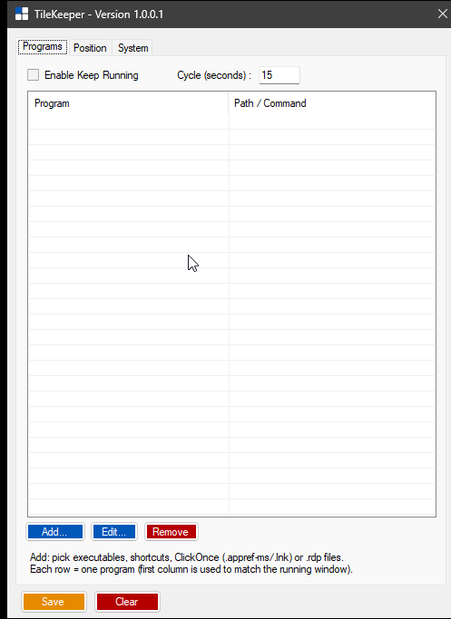
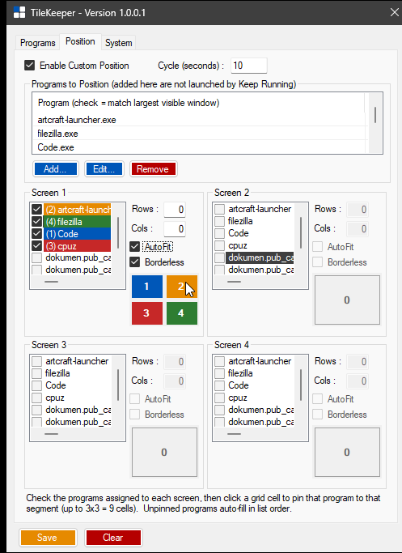
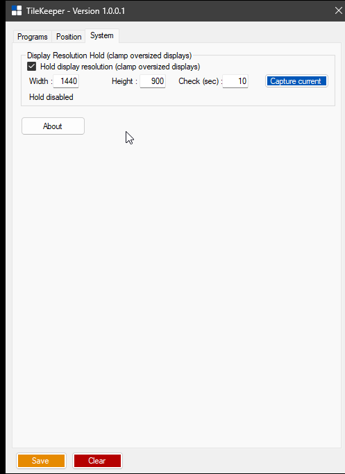
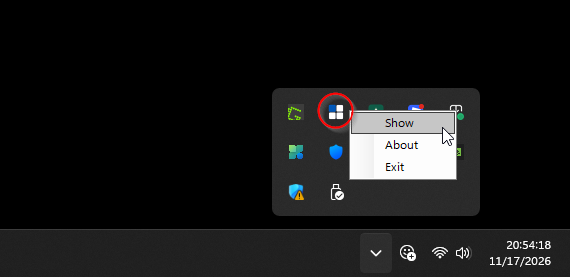
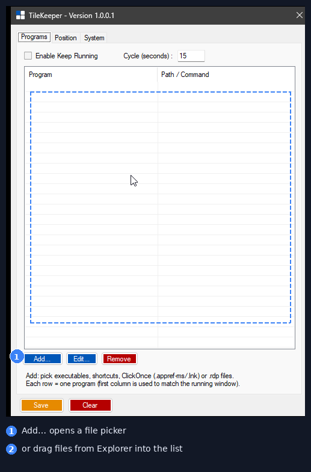
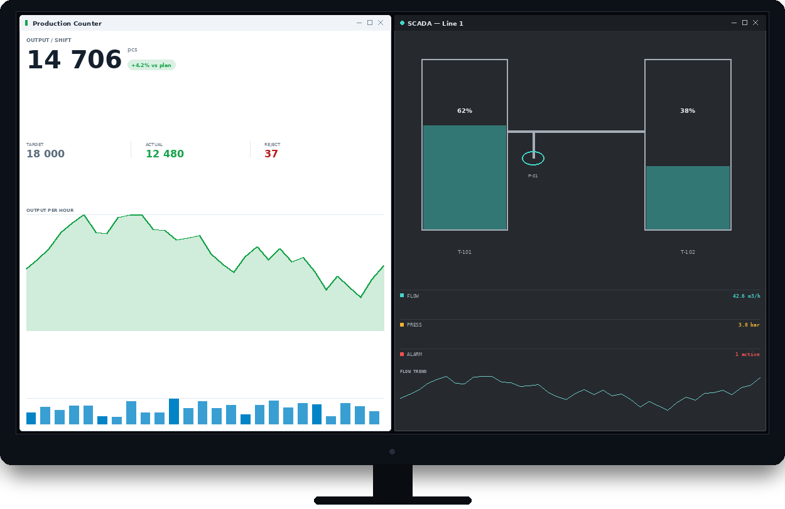
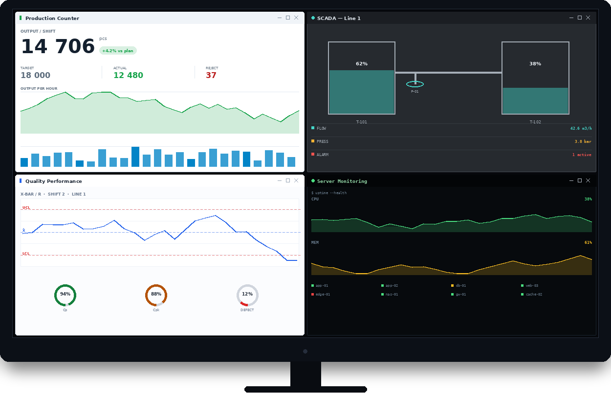
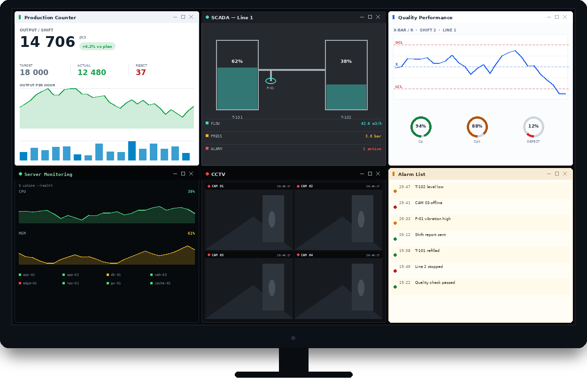
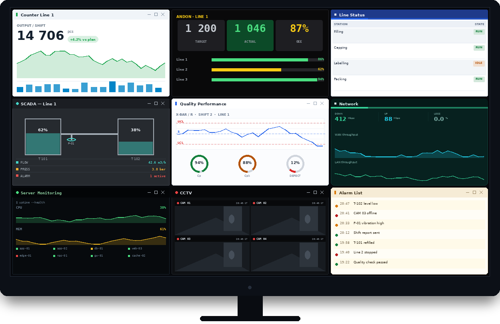

# TileKeeper

Aplikasi tray Windows yang mengingat jendela apa saja yang harus tetap berjalan dan di mana letaknya di monitor — dan menjaga semuanya tetap begitu. Cocok buat yang suka monitoring dan malas menata ulang aplikasi berulang-ulang.

## Ceritanya kenapa saya bikin ini

Saya kerja monitoring, salah satunya mengawasi SCADA, dan aplikasi-aplikasi monitoring saya buka lewat VNC dan RDP. Setiap kali koneksi putus dan tersambung ulang, semua aplikasi harus saya buka lagi dan ditata ulang posisinya di layar. Repetitif dan membosankan.

Ide awalnya sebenarnya sederhana. Saya cuma ingin aplikasi yang mengecek berkala lewat task manager — apakah aplikasi yang harus dijaga masih jalan atau tidak. Kalau mati, dijalankan lagi. Selain itu, dia juga mengecek berkala apakah aplikasi, shortcut, VNC, atau RDP itu masih berada di posisi / petak / cell-nya.

Konsep pemetaan layarnya yaitu membagi layar menjadi beberapa cell. Dari situ dicari koordinat tengahnya (atau z-index-nya), koordinat x/y, serta tinggi dan lebarnya. Setelah tahu jendela harus di mana, TileKeeper menggambar ulang form terluar (outer form) dari window aplikasi itu — bisa menghapus border, menghilangkan title bar, dan lain-lain.

Cukup sederhana, tapi bermanfaat banget untuk pekerjaan saya sehari-hari.

Dia juga ingat di monitor dan kolom mana setiap jendela harus ditempatkan. Maksimal 9 cell (3x3) per layar, maksimal 4 layar — meskipun saya belum pernah coba di atas 2 layar, karena ga punya monitornya hehehe.

## Cara kerjanya

- **Keep Running**: daftar aplikasi yang harus tetap hidup; kalau ada yang mati, dijalankan lagi otomatis (interval bisa diatur).
- **Menata otomatis**: setiap jendela yang cocok dipindah ke monitor dan cell yang kamu tentukan.
- **Tiling**: atur sendiri baris x kolom per layar (sampai 3x3) atau biarkan otomatis.
- **Pin**: pasangkan aplikasi ke cell tertentu; sisanya mengisi berurutan.
- **Borderless**: hilangkan title bar supaya rapat edge-to-edge.
- **Argument-aware**: aplikasi yang sama dengan argumen beda dianggap jendela terpisah.
- **Largest window**: kalau satu aplikasi punya banyak jendela, pilih yang terbesar.

Cocok buat monitoring SCADA dan aplikasi VNC/RDP, tapi bisa dipakai buat apa pun yang jendelanya perlu dijaga tetap di tempatnya — termasuk layar Andon: papan performa, counting produksi, dashboard, dan aplikasi sejenis tampil berdampingan di satu layar, dan selalu kembali ke tempatnya meski layar dimatikan lalu dihidupkan lagi. Kalau mau jalan otomatis dari awal Windows nyala, simpan shortcut TileKeeper ke folder Startup (Win+R → `shell:startup` → tempel shortcut-nya).

## Cara pakai

1. Unduh `TileKeeper.exe` dari Releases (butuh .NET Framework 4.8).
2. Jalankan; ikon muncul di tray.
3. Klik kanan ikon → **Show**, buka tab **Programs**, klik **Add...**, dan pilih `.lnk`, `.appref-ms`, `.rdp`, `.vnc`, atau `.exe`.
4. Nyalakan **Keep Running** dan atur interval (15–30 detik sudah cukup).
5. Buka tab **Position**, centang aplikasi di layar yang diinginkan, atur **Rows**/**Cols**.
6. Klik cell di preview untuk pin aplikasi ke cell tertentu.
7. Klik **Save**. Selesai.

Dua sesi VNC ke server yang sama? Buat dua shortcut dengan argumen berbeda, tambahkan dua-duanya, centang dua-duanya di layar 2, set **Cols = 2**, nyalakan **AutoFit**. Setiap reconnect, dua-duanya balik otomatis ke posisinya.

## Screenshots

|  |  |
|---|---|
|  |  |
| Programs — daftar aplikasi yang dijaga | Position — layar 1–4, cell 3×3, AutoFit, Borderless |
|  |  |
| System — display resolution hold | Tray menu — Show, About, Exit |

## Menambah program

Ada dua cara: seret file dari Explorer langsung ke daftar (tab **Programs** atau **Position**), atau klik **Add…** lalu pilih filenya — bisa beberapa sekaligus. **Edit…** mengganti file pada baris yang sudah ada, **Remove** menghapusnya.

| Berkas | Keterangan |
|---|---|
| `.lnk` | Shortcut apa pun: desktop, Start menu, atau shortcut ClickOnce |
| `.exe` | Programnya langsung |
| `.rdp` | Koneksi Remote Desktop tersimpan, file yang biasa diklik dua kali |
| `.vnc` | Koneksi VNC tersimpan; dibuka lewat viewer yang terpasang (TightVNC, UltraVNC, RealVNC, dan sejenisnya) |
| `.appref-ms` | Aplikasi ClickOnce dari Start menu |

File yang sama tidak ditambahkan dua kali. Dua shortcut ke program yang sama dengan argumen berbeda tetap jadi dua baris, jadi dua host VNC atau dua tampilan SCADA punya posisi sendiri-sendiri. TileKeeper tidak bisa menambahkan dirinya sendiri.

## Contoh tata letak

Ilustrasi satu layar monitor dengan jumlah aplikasi berbeda: production counter, SCADA, quality, server dan network monitoring, CCTV, dan daftar alarm.

Semua gambar di bagian ini adalah **mock desain, bukan tangkapan layar asli dan bukan hasil produksi nyata**. Angka, nama line, alarm, dan tata letaknya dibuat-buat untuk ilustrasi. Kalau ada kemiripan dengan pabrik, line, atau sistem tertentu, itu kebetulan. Tangkapan layar penggunaan asli tidak bisa dipublikasikan karena menyangkut sensitivitas dan kerahasiaan data perusahaan.

|  |  |
|---|---|
|  |  |
| Dua aplikasi berdampingan | Empat aplikasi, 2×2 |
|  |  |
| Enam aplikasi, 3×2 | Sembilan aplikasi, 3×3 (maksimal per layar) |

## Unduh

### v1.0.0 (terbaru)

| Berkas | Keterangan |
|---|---|
| [TileKeeper-win.zip](https://github.com/ASQAL90/TileKeeper/releases/download/v1.0.0/TileKeeper-win.zip) | `TileKeeper.exe` + `TileKeeper.exe.config`, tanpa installer |
| [SHA256SUMS.txt](https://github.com/ASQAL90/TileKeeper/releases/download/v1.0.0/SHA256SUMS.txt) | Checksum SHA-256 |

Butuh .NET Framework 4.8. Unsigned — SmartScreen mungkin memberi peringatan pertama kali jalan.

## Lisensi

MIT, lihat [LICENSE](LICENSE). `nunit.framework.dll` di proyek tes membawa lisensi sendiri.
